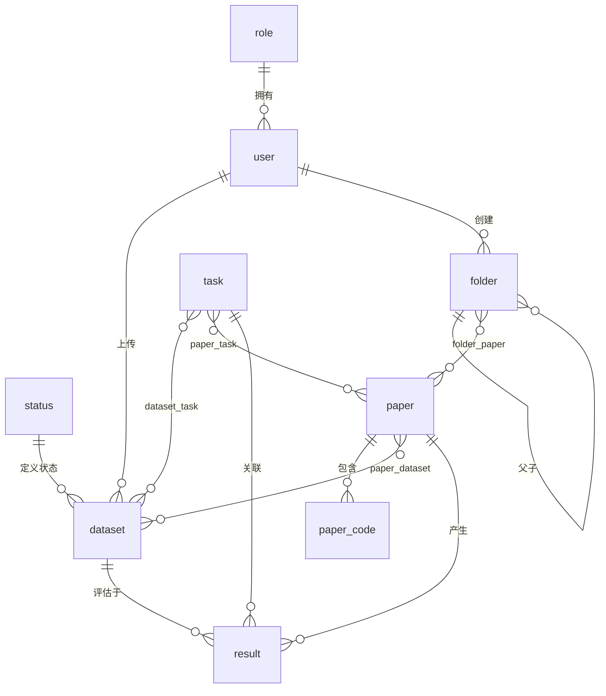

# 数据库设计说明

> 整理人：数据库部分负责人
> 规范化版本：v2（2026-09-06）
> 权威脚本：`database/schema.sql` + `database/seed.sql`

---

## 一、背景

本项目是一个"数据库 + 后端 + 前端"的团队练手项目（Vue 3 + Spring Boot 3 / MyBatis-Plus + MySQL）。
数据库部分的工作是：梳理项目里全部 SQL 脚本与后端实体类、Mapper XML 的对应关系，
把不一致、缺约束、缺表的地方整理完善，并用文档记录。

**整理前的问题**：原脚本只有 9 张表、缺 5 张关键表，用原脚本初始化后**连登录都跑不通**；
同一份库里存在多套互相矛盾的脚本，字段定义与后端代码对不上。

---

## 二、交付物

| 文件 | 说明 |
|---|---|
| `database/schema.sql` | 规范化 v2 建库脚本：**14 张表**，含主外键、唯一约束、索引、逻辑删除/乐观锁、中文注释 |
| `database/seed.sql` | 规范化 v2 演示数据，可重复执行（幂等） |
| `database/check.sql` | 完整性自检脚本：孤儿外键、重复数据、聚合样例 |
| `database/legacy/schema_v1_original.sql` | 原版建表脚本备份（改动前，9 张表） |
| `database/legacy/seed_v1_original.sql` | 原版种子数据备份 |
| 本文档 | 调研结论、设计说明、表说明、遗留建议 |

---

## 三、原有问题（调研发现）

### 3.1 脚本之间、脚本与代码之间不一致

1. **原脚本只有 9 张表**，缺少 `user` / `role` / `status` / `dataset_task` / `paper_code`，
   但原种子数据与后端代码都要使用这些表 → 用原脚本初始化后**无法登录、功能跑不通**。
2. **`dataset` 表结构不一致**：原脚本有 `size DOUBLE`、`tags VARCHAR`，
   而后端实体与 Mapper 用的是 `true_address`（真实下载地址）、`size_formatted`、`downloadCount` 等字段；
   v2 已删除 `size` 与 `tags`。
3. **`paper` 表结构不一致**：老脚本用 `code_url` 单字段保存代码链接；
   当前后端已把"文献-代码"改成多对多的 `paper_code` 表，`paper` 表也改成了 `note_url`（阅读笔记）。
4. **完整导出文件与"干净版"脚本不一致**：旧 Navicat 导出有 14 张表，而 `schema_v1_original.sql` 只有 9 张，
   字段定义也不同，容易误导后来者用错初始化方式。

### 3.2 数据库建模问题（以旧完整导出为准检查发现）

1. `dataset_task.task_id` 是 `INT`，而 `task.id` 是 `BIGINT`，类型不一致且**没有外键**。
2. `paper_code` 的主键只有 `paper_id` → 一篇文献在数据库层只能存一条代码记录，
   但业务明确支持一篇文献挂多个代码仓库。
3. `paper_dataset` 的主键只有 `paper_id` → 一篇文献在数据库层只能关联一个数据集，
   与"一文献多数据集"的业务不符；同时该表混用了"库内数据集"和"外部链接"两种关联方式。
4. `folder.user_id = 1`，而 `user.user_id` 实际从 1001 开始 → 文件夹归属是**孤儿引用**；
   数据集种子中也有 `user_id = 1` 的脏数据。
5. `task` 表使用自增后又手工插入固定 ID，导致 ID 与名称错位，旧种子又按 1~5 连续编号，两边对不上。
6. `folder` 没有指向 `user` 的外键；`user` / `role` / `status` 等表没有统一默认值、索引与注释。
7. `base_address` 语义被混用：库内既存本地相对目录名（如 `VOC2007`），又把外链 URL 也塞进去；
   而详情接口会拿 `base_address` 当文件系统目录去扫描，URL 会被当成目录导致报错。
8. 字符集不统一（`utf8` / `utf8_general_ci` / `utf8mb4_0900_ai_ci` 混用），不利于中文与 Emoji 存储。

### 3.3 其他发现

- 后端 `application.yaml` 里有教学遗留的 `table-prefix: news_`。实体类已用 `@TableName` 显式指定，
  目前不影响运行，但建议删除以免误导。
- `repository` 表与 `paper_code` 表功能重复，当前后端实际使用 `paper_code`，`repository` 属于**遗留表**。

---

## 四、v2 完善内容

### 4.1 建库脚本 `schema.sql`

1. **补齐 5 张缺失表**：`role`、`user`、`status`、`dataset_task`、`paper_code`，最终共 **14 张表**。
2. **字段与后端完全对齐**：以后端实体类 `com.ateavi.pojo.*` 与 `resources/mapper/*.xml` 为准整理列名与类型。
3. **统一建表规范**：`InnoDB` + `utf8mb4` + `utf8mb4_general_ci`，每张表/每个关键字段都有中文注释。
4. **补齐主外键与删除策略**：
   - 字典引用（`user→role`、`dataset→status/user`）用 `ON DELETE RESTRICT`
   - 子记录随父记录删除（关联表、结果表）用 `ON DELETE CASCADE`
   - `folder.parent_id` 自引用用 `ON DELETE CASCADE`；`folder.user_id` 用 `ON DELETE SET NULL`
5. **修正关联表建模**：
   - `dataset_task` / `paper_task` / `folder_paper` 使用**复合主键**，并加反向索引
   - `paper_code` 增加自增主键 `code_id`，加唯一约束 `(paper_id, code_name)` → 支持一文献多代码
   - `paper_dataset` 增加自增主键 `id`，并用**生成列 `ref_code`** 实现
     "同一文献不能重复关联同一数据集/同一外部链接"的数据库层唯一约束
6. **补齐唯一约束与索引**：用户名唯一、任务名唯一、状态码唯一、`dataset.base_address` 唯一，
   并给外键与常用查询字段建索引。
7. **逻辑删除 / 乐观锁规范化**：`is_deleted TINYINT DEFAULT 0`、`version INT DEFAULT 1`，
   与 MyBatis-Plus 的全局 `logic-delete-field` 及 `@Version` 配置对应。
8. **修正 `base_address` 语义**：只允许存 `eavi-static/data/datasets/` 下的**相对目录名**，
   **可为 NULL** 表示本地文档未上架；真实下载地址一律放 `true_address`。

### 4.2 关于 `ref_code` 生成列的设计说明

这是 v2 里唯一一处"用数据库特性解决业务约束"的设计，值得单独说明。

**需求**：`paper_dataset` 一条记录要么关联库内数据集（`dataset_id` 有值），
要么填外部链接（`dataset_url` 有值）。同一条文献**不能重复关联同一个数据集或同一个链接**。

**问题**：普通唯一索引做不到。因为 MySQL 唯一索引对 NULL 的处理是"多个 NULL 视为互不相同"，
而 `(paper_id, dataset_id)` 在外部链接场景下 `dataset_id` 恒为 NULL，拦不住重复。

**方案**：加一个生成列，把两种场景归一化成同一个字符串：

```sql
`ref_code` VARCHAR(1040) GENERATED ALWAYS AS (
   CASE
     WHEN `dataset_id` IS NOT NULL THEN CONCAT('D:', `dataset_id`)
     ELSE CONCAT('U:', COALESCE(`dataset_url`, ''))
   END
 ) STORED,
UNIQUE KEY `uk_paper_dataset_ref` (`paper_id`, `ref_code`)
```

**好处**：把原本只在应用层做的查重（先 `exists()` 再 `insert()`，存在并发竞态）
下沉到数据库层兜底，语义与后端代码完全一致。

**权衡**：生成列会占用存储（`STORED`），且 `VARCHAR(1040)` 让唯一索引偏大。
若将来 `dataset_url` 变长需要同步调整——这是这个方案的代价。

> 这一点欢迎后端同学评估：如果倾向不加生成列，可以改为在应用层加分布式锁或
> 用 `INSERT ... ON DUPLICATE KEY` 配合普通索引，但需要在文档里记录这个取舍。

### 4.3 演示数据 `seed.sql`

包含：5 个角色、4 个数据集状态、2 个账号、6 个 AI 任务、5 个数据集、2 篇文献、
任务关联、代码仓库、数据集关联、Benchmark 结果、文献文件夹树。可重复执行（`ON DUPLICATE KEY UPDATE` + `INSERT IGNORE`）。

- 用户 ID 使用真实的 `1001` / `1002`，文件夹归属用户 `1001`，不再出现 `user_id=1` 孤儿数据。
- `task` 使用明确的固定 ID（1~6），与 `dataset_task` / `paper_task` / `result` 的关联一一对应。
- **仅 `PASCAL VOC 2007`** 在本仓库 `eavi-static/data/datasets/VOC2007/` 下有真实文档；
  其余数据集作为元数据保留在列表中（`base_address = NULL`），避免用 URL 顶替目录。

### 4.4 账号信息

| 用户名 | 姓名 | 密码 | 角色 |
|---|---|---|---|
| `lcy` | 刘晨宇 | `123456` | 管理员 |
| `qmn` | 齐梦男 | `123456` | 管理员 |

密码在库中存 MD5：`e10adc3949ba59abbe56e057f20f883e`。

---

## 五、数据模型



核心业务关系一句话：**用户**管理**文献**与**数据集**；文献按 AI **任务**归类，
关联**数据集**与**代码仓库**，并在数据集上记录 **Benchmark 结果**；用户可把文献放进树形**文件夹**收藏。

### 表清单

| 表 | 用途 | 关键说明 |
|---|---|---|
| `role` | 角色字典 | 管理员 / 数据集管理员 等 |
| `user` | 用户 | `username` 唯一，密码 MD5，逻辑删除 + 乐观锁 |
| `status` | 数据集状态字典 | active / processing / error / archived |
| `task` | AI 任务字典 | 图像分类、目标检测、机器翻译 等 |
| `dataset` | 数据集 | 外链存 `true_address`，本地目录存 `base_address`（可 NULL） |
| `dataset_task` | 数据集-任务 | 复合主键 |
| `paper` | 文献 | `status` 为阅读状态，笔记文件存 `note_url` |
| `paper_task` | 文献-任务 | 复合主键 |
| `paper_code` | 文献-代码仓库 | `(paper_id, code_name)` 唯一 |
| `paper_dataset` | 文献-数据集 | 支持库内 ID 或外部链接，生成列 `ref_code` 防重复 |
| `result` | Benchmark 结果 | 记录模型在 任务+数据集 上的指标 |
| `folder` | 文献文件夹 | 树形：`parent_id` 自引用 |
| `folder_paper` | 文件夹-文献 | 复合主键 |
| `repository` | 旧版代码仓库 | **遗留表，当前后端未使用**，保留兼容 |

---

## 六、与后端代码的对齐核验结果

> 以下是对 `schema.sql` v2 与后端实体类 / Mapper XML 逐字段比对的结论。

### 6.1 完全对齐

`dataset`（14 列）、`paper`（13 列）、`folder`（7 列）、`result`（9 列）、`repository`（6 列）、
`task`、`role`、`status` —— 列名列数与实体字段一一对应。

### 6.2 v2 新增、实体类尚无对应字段

| 表 | v2 新增 | 影响 |
|---|---|---|
| `paper_code` | `code_id`、`created_at` | 自增主键 / 有默认值，**不影响 INSERT** |
| `paper_dataset` | `id`、`ref_code` | `id` 自增；`ref_code` 是 `GENERATED ALWAYS`，**本来就不应被插入** |
| `user` | `created_at`、`updated_at` | 有默认值，不影响 |

**结论**：新增列不会导致现有 INSERT 失败，但建议后端实体类补齐字段以便读取。

### 6.3 类型不一致（2 处）

| 实体字段 | Java 类型 | 数据库列 | 数据库类型 |
|---|---|---|---|
| `PaperCode.paperId` | `Integer` | `paper_code.paper_id` | `BIGINT` |
| `DatasetTask.taskId` | `Integer` | `dataset_task.task_id` | `BIGINT` |

常规数据量下能跑（JDBC 会自动转换），但建议改成 `Long` 保持一致。

### 6.4 实体类缺少 MyBatis-Plus 可见主键（7 个）

MyBatis-Plus 认定主键的规则是：**有 `@TableId` 注解，或者有一个名字叫 `id` 的字段**。
以下 7 个实体类两者都没有：

```
DatasetTask   FolderPaper   PaperCode   PaperDataset   PaperTask   Role   Status
```

**实际影响**（已通过反编译 `mybatis-plus-core-3.5.3.1.jar` 核实）：

- 应用启动时 `TableInfoHelper` 会打印一条 **WARN**：`Can not find table primary key in Class: "..."`。
  这是警告，**不是异常**。
- `BaseMapper.insert()` **仍然可以正常执行**。`Insert.injectMappedStatement` 里，
  当 `keyProperty` 为空时会跳过生成 keyGenerator 的分支，SQL 退化为普通的 `INSERT INTO ... VALUES ...`，
  只是**不会回填自增主键**。
- **真正会失败的是** `selectById` / `updateById` / `deleteById` / `deleteBatchIds` 这类
  "靠主键定位"的方法。

**建议**：给这 7 个实体补 `@TableId`（若无 `id` 字段则按表实际主键加注解，如 `Role` 加 `@TableId("role_id")`）。
注意 `paper_code` 和 `paper_dataset` 的 v2 主键是 `code_id` / `id`，需要先在实体里加对应字段。

> 这一条修正了早期报告中的表述。早期报告写的是"`BaseMapper.insert` / `saveBatch` 会报找不到主键"，
> 经核实不准确：insert 能跑，只有回填主键和按主键定位的操作受影响。

---

## 七、遗留问题与建议（供后端同学参考）

1. **关联表实体缺主键注解**（见 6.4），建议后端同步补注解。
2. **`paper_code.paper_id`、`dataset_task.task_id` 建议改成 `Long`**，与 `paper.id`、`task.id` 的 `BIGINT` 一致。
3. **`dataset` 详情接口未处理 `base_address IS NULL`**：
   外部数据集/未上架文档被点击时，后端应返回"本地文档未上架"的业务错误，而不是把空值当目录扫描
   （当前会抛 `IllegalArgumentException` → HTTP 500）。**这条已写入接口契约第 2.3 节。**
4. **`DatasetMapper.selectMyPage` 的 `GROUP BY dataset.dataset_id`** 在 MySQL `ONLY_FULL_GROUP_BY`
   严格模式下会报错（select 列表含 `status.status`、`user.name`、`GROUP_CONCAT(...)` 等非聚合列）。
   建议按 select 列表完整分组或用 `ANY_VALUE()` 改写。
5. **`application.yaml` 的 `table-prefix: news_` 为教学遗留配置**，实体已显式 `@TableName` 覆盖，建议删除。
6. **`repository` 表与 `paper_code` 重复**，当前后端完全未使用（`RepositoryServiceImpl` 未被任何类注入，
   `/papers/{id}/repositories` 实际走的是 `paper_code`）。若确认废弃可在下一版 schema 中删除。
7. **历史库升级**：本机若要从"旧导出库"升级，需要先 `mysqldump` 导出再按新结构导入，
   不能直接对新库执行旧 dump（表结构差异较大）。如需迁移脚本可后续补充。

---

## 八、结语

本次将数据库脚本从"多版本不一致、缺表缺约束"整理为**一套与后端代码对齐、可重复初始化、
含完整约束与注释**的规范版本，并保留了原始脚本备份。

欢迎对表结构、命名、约束策略提出意见，尤其是 `paper_dataset` 的生成列方案与 `repository` 表的去留。
