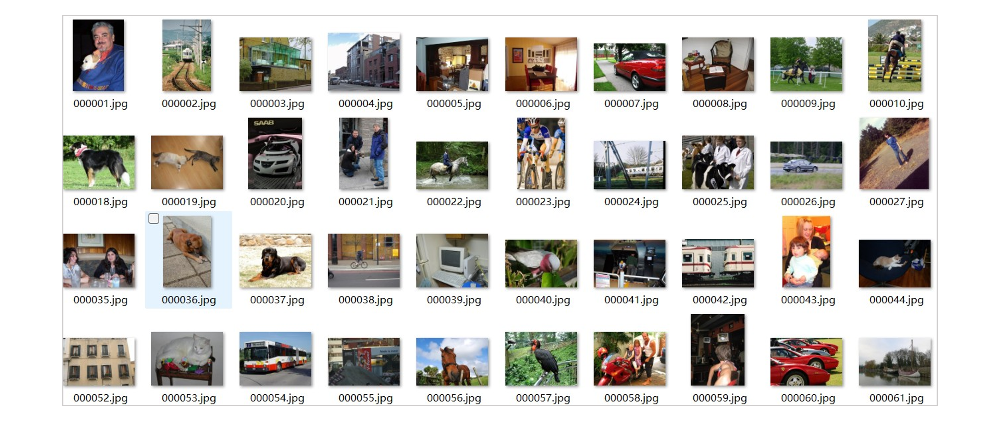

# PASCAL VOC 2007

## 1. 数据集说明
### 1.1 简介

​	PASCAL VOC挑战赛 （The PASCAL Visual Object Classes ）是一个世界级的计算机视觉挑战赛, PASCAL全称：**Pattern Analysis, Statical Modeling and Computational Learning**，是一个由欧盟资助的网络组织。许多计算机视觉模型（分类、检测、分割、动作识别等）均源于 PASCAL VOC 挑战赛及其数据集，尤其是目标检测领域的 R-CNN 系列、YOLO 和 SSD 等，然而，该挑战赛已于2012年停止举办了。

​	对于现在的研究者来说比较重要的两个年份的数据集是 PASCAL VOC 2007 与 PASCAL VOC 2012，在论文中常常出现。VOC2012用于分类和检测的数据包含 2008-2011年间的所有数据，并与VOC2007互斥。VOC2012用于分割的数据中train+val包含 2007-2011年间的所有数据，test包含2008-2011年间的数据，没有包含07年的是因为07年的test数据已经公开了。

​	PASCAL VOC 2007（以下简称VOC2007）有两个挑战任务：**分类**、**检测**，以及两个附属任务：**像素级分割**、**人物布局**。2007 年挑战赛的图像均来自 Flickr（一个在线照片分享平台），因其为非研究人员拍摄的个人照片，数据集无偏且多样，涵盖丰富的拍摄条件，很少出现单一对象专属的情况。本文档主要介绍**<span style="color:red">用于多标签分类任务的PASCAL VOC 2007数据集</span>**的特性及使用方式。



>图1. VOC2007数据集示例

​	

### 1.2 数据集特性

- VOC2007数据集常被分为**trainval**和**test**两个部分（当然trainval又可以被分成train和val），因为实际使用过程中，trainval常作为训练集被用于训练，test作为测试集测试性能。其中，trainval具有图片**5011**张，test有图片**4952**张。

- VOC2007共有**20**个类别，每张图片都有精准标注。
- 样本图片分辨率在**300×500**上下不等， 实际使用过程中会resize成想要的分辨率。


> 图2.  VOC2007 类别。叶节点对应 20 个类别。每个类别被纳入挑战的年份通过上标标注：2005-1、2006-2、2007-3。

---

## 2. 下载方式
- [官方网站](http://host.robots.ox.ac.uk/pascal/VOC/) （经常打不开，建议从本文档提供的连接下载） 

## 3. 文件结构

- 以下为**本文档提供数据集**的文件结构，其他渠道下载的文件可能目录会有所不同，但压缩包命名，使用方式等是一致的。

```plaintext
PASCAL VOC 2007/
│── Development Kit/            
│   ├── devkit_doc_07-Jun-2007.pdf	# 官方文档
│   ├── index.html	# 类似使用指南
│   ├── VOCdevkit_08-Jun-2007.tar	# 开发包的压缩文件，有一些官方的工具代码
│   └── VOCtrainval_06-Nov-2007.tar	# 完整训练集+完整验证集（数据+标注）
│
│── Test Data/            
│   ├── VOCtestnoimgs_06-Nov-2007.tar # 测试集的标注文件，用于提交什么的
│   └── VOCtest_06-Nov-2007.tar # 完整测试集（数据+标注）

```

- 在**分类任务**中，我们仅使用<span style="color:blue">VOCtrainval_06-Nov-2007.tar</span>与<span style="color:blue">VOCtest_06-Nov-2007.tar</span>，将两个压缩包分别解压，如下：
```plaintext
VOCtrainval_06-Nov-2007/VOCdevkit/VOC2007/
│── Annotations/	# 标注文件，每张图像对应一个xml，包含其关联的每个类别名称，目标框等        
│   ├── 000005.xml	
│   └── ...
|
│── ImageSets/	# 保存数据划分文件，全是.txt
│   ├── Main/	# 分类与检测任务的划分	
│   ├── layout/	# 人物布局任务
│   └── Segmentation/	# 分割任务
|
│── JPEGImages/	# 所有原始图像（.jpg格式）
|
|── SegmentationClass/	# 像素级的语义分割标注（.png）
|
└── SegmentationObject/	# 像素级的实例分割标注（.png）

VOCtest_06-Nov-2007/VOCdevkit/VOC2007/	# 形式结构与trainval相同
│── Annotations/	      
|
│── ImageSets/
│   ├── Main/
│   ├── layout/
│   └── Segmentation/
|
│── JPEGImages/
|
|── SegmentationClass/
|
└── SegmentationObject/
```


## 4.使用示例

​	由于trainval与test存在于不同文夹中，为了方便加载，本案例做法是将<span style="color:blue">VOCtest_06-Nov-2007</span>目录内**Annotations**，**Main**及**JPEGImages**文件夹中的文件，均复制到<span style="color:blue">VOCtrainval_06-Nov-2007</span>目录中对应的文件夹下。至此，训练集测试集均可用相同的data_path（即<span style="color:red">voc2007文件夹</span>）读取。

- 读取数据所用函数

```python
"""
Author: Mengnan Qi
Email: mnqi@stu.xidian.edu.cn
Date: 2025-09-29
Description: 示例脚本，用于读取VOC2007数据集做分类任务，代码为得到加载VOC所用的Dataset以便深度学习训练。
"""
import os
import numpy as np
import torch
from torch.utils.data.dataset import Dataset
from PIL import Image
import xml.etree.ElementTree as ET

class VOC2007_handler(Dataset):
    def __init__(self, X, Y, data_path, transform=None, random_crops=0):
        self.X = X
        self.Y = Y
        self.transform = transform
        self.random_crops = random_crops
        self.data_path = data_path

    def __getitem__(self, index):
        x = Image.open(self.data_path + '/JPEGImages/' + self.X[index] + '.jpg').convert("RGB")

        if self.random_crops == 0:
            x = self.transform(x)
        else:
            crops = []
            for i in range(self.random_crops):
                crops.append(self.transform(x))
            x = torch.stack(crops)

        y = self.Y[index]

        return x, y, index

    def __len__(self):
        return len(self.X)

def get_VOC2007(data_path):
    classes = ('aeroplane', 'bicycle', 'bird', 'boat',
                    'bottle', 'bus', 'car', 'cat', 'chair',
                    'cow', 'diningtable', 'dog', 'horse',
                    'motorbike', 'person', 'pottedplant',
                    'sheep', 'sofa', 'train', 'tvmonitor')
    num_classes = len(classes)
    class_to_ind = dict(zip(classes, range(num_classes)))

    # ----training set ---
    with open(data_path + '/ImageSets/Main/' + 'trainval' + '.txt') as f:
        annotations = f.readlines()
    annotations = [n[:-1] for n in annotations]

    names = []
    labels = []
    # 每个样本
    for af in annotations:
        if len(af) != 6:
            continue
        filename = os.path.join(data_path, 'Annotations', af)
        tree = ET.parse(filename + '.xml')
        objs = tree.findall('object')
        num_objs = len(objs)

        boxes_cl = np.zeros((num_objs), dtype=np.int32)

        for ix, obj in enumerate(objs):
            cls = class_to_ind[obj.find('name').text.lower().strip()]
            boxes_cl[ix] = cls

        lbl = np.zeros(num_classes)
        lbl[boxes_cl] = 1
        labels.append(lbl)  # 加入multi-hot 标签
        names.append(af)  # 加入纯净的name

    # 没有打乱
    train_data = np.array(names)
    train_labels = np.array(labels).astype(float)

    # ----test set ---
    with open(data_path + '/ImageSets/Main/' + 'test' + '.txt') as f:
        annotations = f.readlines()
    annotations = [n[:-1] for n in annotations]

    names = []
    labels = []
    # 每个样本
    for af in annotations:
        if len(af) != 6:
            continue
        filename = os.path.join(data_path, 'Annotations', af)
        tree = ET.parse(filename + '.xml')
        objs = tree.findall('object')
        num_objs = len(objs)

        boxes_cl = np.zeros((num_objs), dtype=np.int32)

        for ix, obj in enumerate(objs):
            cls = class_to_ind[obj.find('name').text.lower().strip()]
            boxes_cl[ix] = cls

        lbl = np.zeros(num_classes)
        lbl[boxes_cl] = 1
        labels.append(lbl)  # 加入multi-hot 标签
        names.append(af)  # 加入纯净的name

    # 没有打乱
    test_data = np.array(names)
    test_labels = np.array(labels).astype(float)

    return train_data, train_labels, test_data, test_labels

```

- 使用示例

```python
from torchvision import transforms
T = transforms.ToTensor()

train_data, train_labels, test_data, test_labels = get_VOC2007(r'C:\Users\Q\Desktop\MY_CODE\DATA\VOC2007')
train_set = VOC2007_handler(train_data, train_labels, r'C:\Users\Q\Desktop\MY_CODE\DATA\VOC2007', T, random_crops=0)
test_set = VOC2007_handler(test_data, test_labels, r'C:\Users\Q\Desktop\MY_CODE\DATA\VOC2007', T, random_crops=0)
```

## 5. 参考资料

### 5.1 相关论文

- [Everingham M, Van Gool L, Williams C K I, et al. The pascal visual object classes (voc) challenge[J]. International journal of computer vision, 2010, 88(2): 303-338.](https://www.pure.ed.ac.uk/ws/portalfiles/portal/7879113/ijcv_voc09.pdf)(VOC2007数据集情况总结，引用26k+)

### 5.2 其它资料

[1] [目标检测数据集PASCAL VOC简介 - arleyzhang](https://arleyzhang.github.io/articles/1dc20586/)

[2] [【目标检测数据集】VOC2007 数据集介绍 - [牧锦程](https://www.zhihu.com/people/58-41-86-79)（知乎）](https://zhuanlan.zhihu.com/p/692328776)

[3] [PascalClassificationPytorch - bbrattoli（github）](https://github.com/bbrattoli/PascalClassificationPytorch/tree/master)

[4] ChatGPT 5 👍

## 6.备注

- 齐梦男（mnqi@stu.xidian.edu.cn）- 2025-09-29


